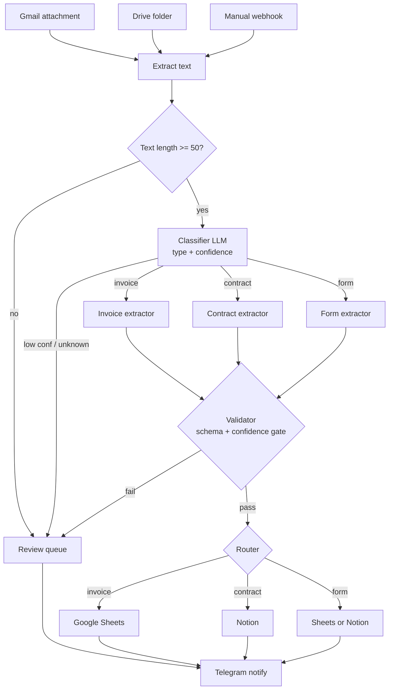

# DocFlow AI

## Project status and evidence

**Portfolio build.** Local checks do not establish live Gmail/Drive delivery or end-to-end acceptance of every document type.

**My contribution:** Built a reference architecture with intake, classification, extraction, deterministic validation and review routing.

**Verification:** 30/30 local validator/export checks passed on 20 October 2026.


Turn incoming business documents into clean, structured data automatically. DocFlow AI watches Gmail and Google Drive for invoices, contracts, and intake forms, classifies each one, extracts the fields with an LLM behind validation and confidence gates, and routes the result to Google Sheets or Notion, with a human-in-the-loop review queue with an explicit review path for uncertain documents.


## The problem

Teams that handle a steady stream of documents (a restaurant's supplier invoices, an agency's contracts, a clinic's intake forms) key the same data into a spreadsheet by hand, every day. It is slow, it is error-prone, and it does not scale. The obvious fix, "just call an LLM on the PDF," breaks the moment a model hallucinates a total, returns malformed JSON, or quietly mishandles a scanned page, because there is no gate catching it.

## What it does

- Ingests documents from three entry points (Gmail attachment, Drive folder, or a manual webhook for testing).
- Classifies each document (invoice, contract, form, or unknown) with a confidence score.
- Extracts a fixed, per-type JSON schema using GPT-4o-mini via OpenRouter.
- Validates every extraction: required fields, type and date-format checks, number sanity (line-items vs subtotal), and a confidence gate.
- Routes clean results to Google Sheets (invoices) or Notion (contracts), configurable per client.
- Sends anything below the confidence threshold or failing validation to a review queue with a reason, and pings the owner on Telegram. The validator never silently drops a document.

## Architecture

One n8n workflow per concern, wired together with `Execute Workflow` calls, so the same classifier serves every intake path and a bad prompt in one extractor cannot break another.



Full diagram, data contract, and stack rationale in [docs/flow.md](docs/flow.md); schemas, validator rules, and output formats in [docs/specs.md](docs/specs.md).

## Guardrails (the part that makes it production-shaped)

- **Confidence gates at every stage**: text-length gate before classify, classifier gate (>= 0.7), extractor gate (>= 0.8 overall), and per-critical-field gates (>= 0.7). Thresholds are config-driven, so stricter clients can dial them up.
- **A validator Code node per extractor**: required-field, type, ISO-date, and number-sanity checks (including invoice line-items vs subtotal within 5%).
- **A single review-notifier workflow** so every failure path logs to a `review_queue` tab and alerts Telegram through one code path, not four.
- **A repeatable test harness**: `tests/validators.js` plus fixtures for the clean and every broken case (missing fields, bad currency, math mismatch, start-after-end), run with `node tests/run-tests.js`. The validator logic in the tests and in the n8n Code nodes is kept in sync deliberately.

## Stack

n8n (self-hosted), GPT-4o-mini via OpenRouter (OpenAI-compatible HTTP), Google Sheets, Notion, Telegram, and Supabase for the optional audit log. LLM transport is a plain HTTP Request node so the model can be swapped without depending on an n8n node version.

## Cost, by design

Per document the model spend is small: a classifier call is roughly 500 input / 30 output tokens and an invoice extraction roughly 1,500 input / 400 output, so extraction lands around a tenth of a cent per document at GPT-4o-mini rates. The dominant cost is the human review you avoid, not the tokens.

## Repository layout

```
n8n-exports/      importable workflow JSON, one per concern (01-07 + a manual webhook)
workflows/        a markdown spec per workflow + the versioned LLM prompts
docs/             flow, specs, setup, document-types, runbook, optimization notes
config/           client-config.example.json + JSON schema (real per-client config stays private)
tests/            validators.js + fixtures + run-tests.js
```

## Run it

1. Import the workflows from `n8n-exports/` in the order listed in [docs/setup.md](docs/setup.md) (they reference each other, so order matters), then re-link the `Execute Workflow` nodes.
2. Create the credentials in [docs/setup.md](docs/setup.md) (Gmail, Drive, Sheets, Notion, Telegram, OpenRouter). No secret is committed here; the OpenRouter key lives in an n8n credential, never in the JSON.
3. Copy `config/client-config.example.json`, fill in the per-client IDs, and follow the onboarding checklist.
4. `node tests/run-tests.js` to confirm the validators behave before going live.

## Status

A working reference build (invoice pipeline is the shipping-first MVP; contract and form extractors follow the same pattern). Published as a template for AI document automation, not as a shared client deployment.

## License

MIT, see [LICENSE](LICENSE).
